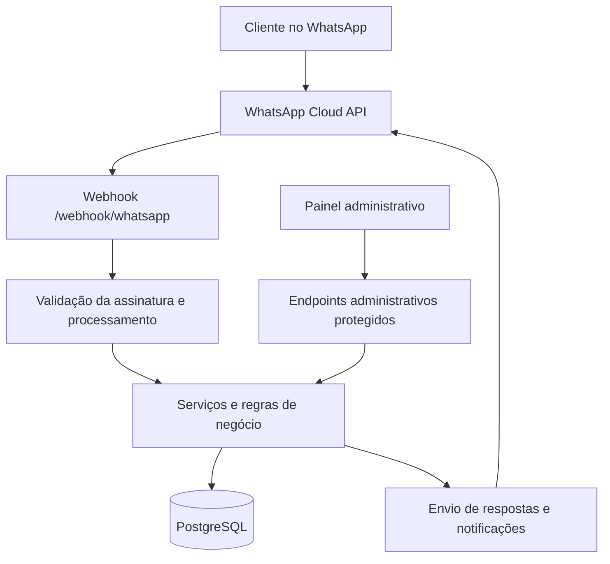

# API de Agendamento via WhatsApp

**Backend de agendamentos automatizados desenvolvido em Java e Spring Boot, integrado à API oficial do WhatsApp Business (Meta).**

O sistema permite que clientes escolham serviços, consultem horários disponíveis e confirmem agendamentos diretamente pelo WhatsApp. As regras de disponibilidade e os dados das reservas são gerenciados pela API, que também oferece recursos administrativos para profissionais e estabelecimentos.

> **Contexto:** projeto independente desenvolvido e implantado em ambiente de produção. Este repositório concentra a API e contém, na pasta `docs/`, documentação técnica e arquivos de apoio do painel administrativo.

## Funcionalidades

- **Agendamento conversacional:** seleção de serviços, data, horário e confirmação por mensagens interativas.
- **Disponibilidade:** verificação de expediente, intervalos, bloqueios de datas e duração do serviço.
- **Prevenção de conflitos:** validações de disponibilidade no processo de confirmação da reserva.
- **Múltiplos serviços:** seleção de mais de um serviço em uma reserva, com cálculo de preço e duração totais.
- **Gestão de profissionais:** configurações e agendas individualizadas.
- **Catálogo de serviços:** cadastro, edição, ativação e desativação.
- **Comunicação automatizada:** mensagens de confirmação, cancelamento e notificações.
- **Atendimento humano:** mecanismos de pausa do atendimento automatizado.
- **Administração:** endpoints e painel de apoio protegidos por autenticação.

O modelo também contempla estabelecimentos de diferentes segmentos que trabalham com serviços e horários, preservando algumas nomenclaturas de barbearia no código por compatibilidade.

## Tecnologias

| Categoria | Tecnologias |
| --- | --- |
| Linguagem | Java 17 |
| Framework | Spring Boot 4.1.1 |
| Persistência | Spring Data JPA, PostgreSQL |
| Segurança | Spring Security; validação de assinatura do webhook |
| Integração | WhatsApp Business Cloud API (Meta), Spring Cloud OpenFeign |
| Build e testes | Gradle, JUnit e ferramentas de teste do Spring |
| Infraestrutura | Docker, Docker Compose e Linux |
| Integração contínua | GitHub Actions |

## Visão geral da arquitetura

A aplicação segue uma organização em camadas, com responsabilidades distribuídas entre controladores, serviços, entidades de domínio, repositórios e componentes de infraestrutura.



**Estrutura do código:**

```text
src/main/java/com/guilhermelevi/barbearia/
├── admin/                  # Endpoints e configurações administrativas
├── domain/                 # Entidades, enums e exceções de domínio
├── dto/                    # Objetos de entrada e saída
├── infrastructure/whatsapp # Webhook e integração com a Meta
├── repositories/           # Persistência de dados
└── service/                # Regras de negócio e fluxos de conversa
```

### Exemplo de fluxo de agendamento

1. O cliente inicia uma conversa pelo WhatsApp.
2. A API conduz a escolha de um ou mais serviços.
3. O sistema apresenta datas e horários compatíveis com a duração total e o expediente.
4. Na confirmação, as regras de disponibilidade e validade dos serviços são verificadas novamente.
5. O agendamento é persistido e a resposta de confirmação é enviada ao cliente.

## Execução local

### Pré-requisitos

- Docker e Docker Compose instalados.
- Credenciais e configuração válidas da **WhatsApp Business Cloud API**, para testar as mensagens reais.
- Um endereço HTTPS acessível publicamente, caso deseje receber webhooks da Meta durante o desenvolvimento.

O projeto contém `Dockerfile`, `compose.yaml` e Gradle Wrapper. O Compose cria a aplicação e um banco PostgreSQL.

### 1. Clonar o repositório

```bash
git clone https://github.com/levidevv-hub/api-barbearia.git
cd api-barbearia
```

### 2. Configurar variáveis de ambiente

Crie um arquivo `.env` na raiz do projeto e informe os valores da sua **própria** instalação:

```dotenv
DB_PASSWORD=defina-uma-senha-local
WHATSAPP_TOKEN=token-da-sua-integracao
WHATSAPP_VERIFY_TOKEN=token-de-verificacao-do-webhook
META_APP_ID=id-do-seu-aplicativo-meta
META_APP_SECRET=segredo-do-seu-aplicativo-meta
BLOQUEIO_TESTE_CHAVE=chave-de-teste-local
ADMIN_USERNAME=admin-local
ADMIN_PASSWORD_HASH=hash-bcrypt-da-senha-administrativa
```

Para informações sobre a geração do hash BCrypt e autenticação do painel, consulte [`docs/painel-admin.md`](docs/painel-admin.md).

**Importante:** não versione o `.env` e não utilize credenciais reais em commits, prints ou exemplos. O arquivo `.env` já está incluído no `.gitignore`.

### 3. Subir os containers

```bash
docker compose up -d --build
```

Por padrão, o Compose publica a aplicação na porta `8080` da interface local (`127.0.0.1`) e mantém o PostgreSQL na rede interna dos containers. A integração com o WhatsApp requer configurar corretamente o webhook e as credenciais da Meta.

### 4. Executar testes

Com Java 17 disponível, execute:

```bash
./gradlew test
```

A suíte contém testes de serviços, controladores, regras de negócio e cenários de integração. **Alguns testes de integração precisam de um PostgreSQL de teste configurado**; o workflow em [`.github/workflows/gradle.yml`](.github/workflows/gradle.yml) mostra o ambiente usado na integração contínua.

## Pontos técnicos relevantes

- **Regras de horário:** a disponibilidade considera expediente, pausas, bloqueios e duração da reserva.
- **Revalidação:** o fluxo de confirmação verifica alterações de serviços e disponibilidade antes de efetivar a reserva.
- **Segurança do webhook:** o endpoint de recebimento valida a assinatura `X-Hub-Signature-256`.
- **Segurança administrativa:** o painel utiliza mecanismos de autenticação e proteção CSRF.
- **Testabilidade:** existem testes automatizados para fluxos conversacionais, serviços, persistência e endpoints.
- **Implantação:** a aplicação usa imagem Docker com estágio de build separado e execução com usuário não privilegiado.

## Documentação complementar

- [Agendamento para diferentes segmentos e múltiplos serviços](docs/multinicho-multiplos-servicos.md)
- [Atendimento humano e pausa da automação](docs/atendimento-humano.md)
- [Regras de bloqueio e mensagens aos clientes](docs/bloqueio-mensagem-clientes.md)
- [Painel administrativo e autenticação](docs/painel-admin.md)
- [Central administrativa no WhatsApp](docs/central-whatsapp-administrativa.md)

## Demonstração

O fluxo real de agendamento pelo WhatsApp está apresentado na seção **Destaques** do [meu LinkedIn](https://www.linkedin.com/in/levideev/).

## Autor

Desenvolvido por **Guilherme Levi** como projeto independente.

- [GitHub](https://github.com/levidevv-hub)
- [LinkedIn](https://www.linkedin.com/in/levideev/)